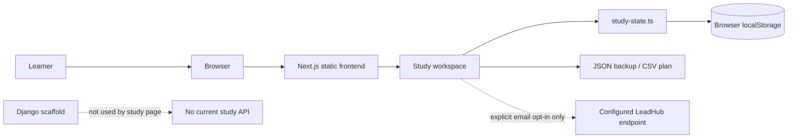
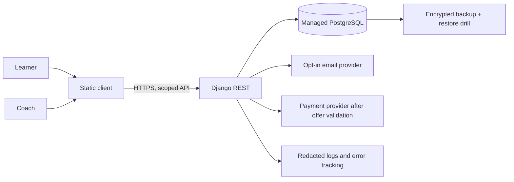

# Cramwise architecture

**Snapshot:** 17 Nov 2026. This describes the current repository and a staged target, not a claim that future systems exist.

## Current system

- `frontend/app/study-workspace.tsx` is a client component for interactive planning, timer, progress and notes.
- `frontend/app/study-state.ts` owns normalized local state and browser storage subscription. Its key is `last-minute-study.v1`; reads are normalized for compatibility with older data.
- A versioned JSON file is the user-controlled backup path. CSV exports the daily plan. Browser localStorage is origin/device-specific, not a durable server backup.
- LeadHub is a separate, optional form. Only a user who opts in submits an email and consent/source metadata; no study state is sent. It depends on build-time `NEXT_PUBLIC_LEADHUB_URL` and a configured HTTPS endpoint.
- The Django project exists in the repository but is not called by the current study UI. Do not describe it as production backend infrastructure.
- Static deployment is configured through Render. No auth, database, billing, server-side analytics or account deletion/export endpoints currently exist because there are no accounts.

## Architecture boundaries

1. Keep the core planner useful without an account or network. Treat browser state as sensitive personal study data even though it is not special-category data by default.
2. Keep import parsing, validation, and state migrations in the state module with tests; UI code owns confirmation and status messaging.
3. Never include notes or topic data in LeadHub, analytics, URLs, logs, or error reports.
4. Use no third-party analytics until retention, consent, audience age, and vendor terms have been reviewed.
5. Keep billing out of the core app until a buyer commits to a pilot and the offer, taxes, refund/cancellation policy, and support burden are known.

## Conditional future architecture: only after a paid tutor pilot

If a signed pilot requires shared plans, first write a new ADR. A minimal candidate is Django REST API + managed PostgreSQL, with tenant/workspace boundaries, verified account auth, role-based access, explicit learner-to-tutor sharing, per-field consent and deletion/export. Keep study notes private by default. Use environment-based credentials, rate limits, audit events for sharing changes, encrypted transport/storage, backups with restore drills, and a documented retention schedule. Add billing only after a recurring offer is validated. This is a design candidate, not an implementation commitment.

### Candidate pilot service diagram

## Operations and quality gate

- CI: lint, TypeScript check, state unit tests, dependency audit and static build (workflow in `.github/workflows/`).
- Release: review build output and static headers/render configuration; deploy remains owner-controlled.
- Recovery: learners can download JSON and restore with a replacement preview. Clear-data behavior and backup migration need tests for every format change.
- Required before a paid pilot: age/privacy review, user support owner, retention/deletion plan, uptime expectations, backup restore test, incident contact, and a verified email sender/domain.
- Rollback: redeploy previous static artifact. Because there is no server-owned study database, restoring product code does not roll back users' browser state.

See [ADR-001](decisions/ADR-001-local-first-data.md) for the data-storage decision and [Market Research](MARKET_RESEARCH.md) for demand limitations.
